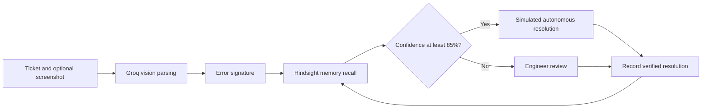

<p align="center">
  <a href="https://github.com/hkhearts/Autofix-Ai">
    
  </a>
</p>

<h1 align="center">Autofix.AI</h1>
<p align="center"><strong>Self-healing L1/L2 IT support, powered by multimodal vision and persistent incident memory.</strong></p>

<p align="center">
  <a href="https://fastapi.tiangolo.com/"></a>
  <a href="https://nextjs.org/"></a>
  <a href="https://www.python.org/"></a>
  <a href="https://www.typescriptlang.org/"></a>
  <a href="https://groq.com/"></a>
  <a href="https://vectorize.io/"></a>
  <a href="https://render.com/"></a>
</p>

<p align="center">
  <a href="#screenshots">Screenshots</a> | <a href="#what-it-does">Overview</a> | <a href="#run-locally">Run locally</a> | <a href="#deploy-to-render">Deploy</a> | <a href="#api">API</a>
</p>

Autofix-AI is an IT support ticketing demo that combines screenshot-aware ticket intake, resolution recommendations, and a learning loop. Verified fixes are recorded in Hindsight memory; similar future incidents can reuse those resolutions, while lower-confidence cases remain in the human review queue.

## Screenshots

<p align="center">
  <a href="frontend/Logo/readme-landing.png"></a>
  <a href="frontend/Logo/readme-console.png"></a>
</p>
<p align="center"><sub>Select either image to view it full size. Screenshots use the bundled demo data.</sub></p>

## What It Does

- **Ticket intake:** create and prioritize incidents, with optional screenshots for error analysis.
- **Vision-assisted parsing:** use Groq vision models to extract useful details from uploaded error images.
- **Resolution recall:** search Hindsight memory for similar incidents and recorded resolutions.
- **Human review:** route lower-confidence recommendations through engineer verification.
- **Learning loop:** record verified resolutions so future tickets can reuse them.
- **Operations console:** inspect tickets, memory patterns, and performance in a responsive dashboard with light and dark themes.

## How It Works



## Run Locally

**Requirements:** Python 3.11 or newer, Node.js 20 or newer, and npm. Groq and Hindsight API keys are optional for local development; without a Hindsight key, the backend uses its local memory implementation.

1. Copy `.env.example` to `.env` at the repository root and add API keys if available.
2. From the repository root, install the backend dependencies and start the API:

```bash
python -m pip install -r backend/requirements.txt
python -m uvicorn backend.main:app --reload --port 8000
```

3. In a second terminal, install and start the frontend:

```bash
cd frontend
npm ci
npm run dev
```

Open [localhost:3000](http://localhost:3000). The API health check and interactive API docs are at [localhost:8000/health](http://localhost:8000/health) and [localhost:8000/docs](http://localhost:8000/docs). The backend preloads demo tickets on startup.

### Demo Login

| Field | Value |
| --- | --- |
| Organization | Acme Global Industries (`acme-corp`) |
| Email | `admin@autofix.ai` |
| Password | `password123` |

These are demo credentials only. Do not use them for a public or production deployment.

## Deploy to Render

The repository includes a Render Blueprint in [`render.yaml`](render.yaml), configured to create a Python API and a Next.js web service.

1. Open [Render Blueprints](https://dashboard.render.com/blueprints) and choose **New Blueprint Instance**.
2. Connect [`hkhearts/Autofix-Ai`](https://github.com/hkhearts/Autofix-Ai) and select the `main` branch.
3. Review the services and provide `GROQ_API_KEY` and `HINDSIGHT_API_KEY` when prompted. These values are optional for the demo; leaving them unset uses local memory and omits cloud vision features.
4. Deploy the Blueprint. Render will connect the frontend to the backend using the service reference in `render.yaml`.

The configured services are `autofix-ai-backend` and `autofix-ai-frontend`. Render assigns their `onrender.com` addresses when the Blueprint is created; the frontend address is shown in its service dashboard.

## Docker

From the repository root:

```bash
docker compose up --build
```

The frontend is served on port 3000 and the backend API on port 8000.

## API

| Method | Endpoint | Purpose |
| --- | --- | --- |
| `GET` | `/health` | Service and memory health |
| `GET` | `/api/tickets` | List tickets |
| `GET` | `/api/tickets/{id}` | Read a ticket |
| `POST` | `/api/tickets` | Create a ticket, optionally with an image |
| `POST` | `/api/tickets/{id}/feedback` | Verify a resolution and add it to memory |
| `POST` | `/api/tickets/{id}/reply` | Add a ticket reply |
| `GET` | `/api/memory/stats` | Read memory statistics |
| `GET` | `/api/memory/search?q={query}` | Search recorded resolutions |
| `POST` | `/api/auth/login` | Sign in with demo credentials |

## Configuration

The root [`.env.example`](.env.example) documents the available settings, including `GROQ_API_KEY`, `HINDSIGHT_API_KEY`, `HINDSIGHT_BASE_URL`, `HINDSIGHT_BANK_ID`, `CONFIDENCE_THRESHOLD`, and `CORS_ORIGINS`. Never commit real API keys.

Hindsight Cloud users can use promo code `MEMHACK99` for developer credits at [Vectorize](https://vectorize.io/).
