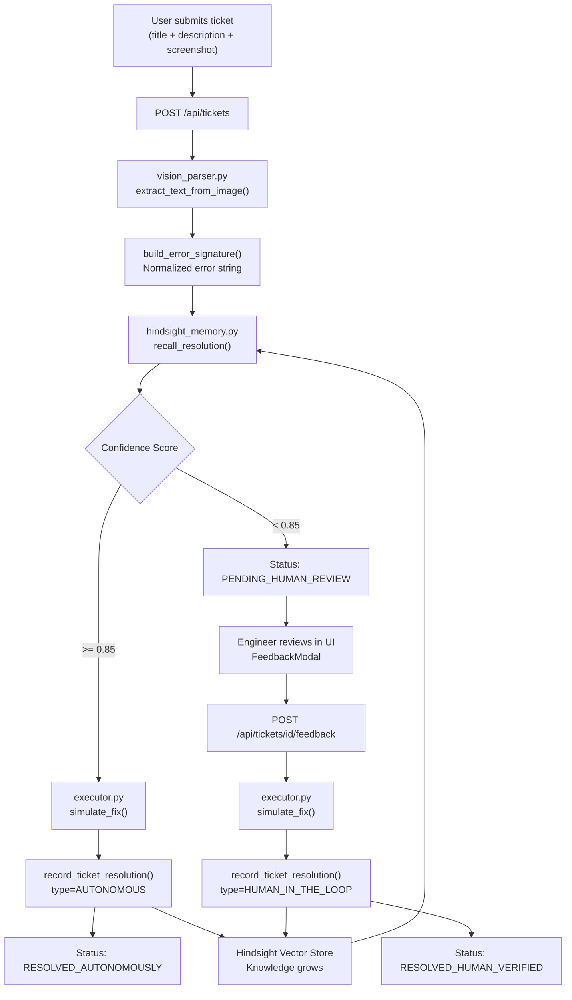

# 🤖 Autofix-AI — Complete Build Plan
### Self-Healing L1/L2 IT Support Agent with Vision & Hindsight Memory

> [!IMPORTANT]
> This document is the **authoritative build spec** for the Autofix-AI project. Each phase is self-contained and ordered so an agent can execute it end-to-end without ambiguity. Complete every checkpoint before advancing to the next phase.

---

## 📐 Final Directory Structure (Target)

```
autofix-ai/
├── Dockerfile                        # Multi-stage: backend + frontend
├── docker-compose.yml                # Orchestrates FastAPI + Next.js
├── .env.example                      # All required env var templates
├── README.md                         # Full setup & usage guide
├── data/
│   └── initial_tickets.json          # 15 seed L1/L2 tickets
├── scripts/
│   └── seed_data.py                  # Populates Hindsight with seed tickets
├── backend/
│   ├── main.py                       # FastAPI app, routes, CORS
│   ├── requirements.txt
│   └── services/
│       ├── vision_parser.py          # Screenshot OCR → error signature
│       ├── hindsight_memory.py       # Hindsight SDK: recall + record
│       └── executor.py               # Simulated L1/L2 fix executor
└── frontend/
    ├── package.json
    ├── tailwind.config.ts
    ├── next.config.ts
    ├── app/
    │   ├── layout.tsx
    │   ├── page.tsx                  # Main ticketing console
    │   └── api/
    │       └── proxy/route.ts        # Optional: Next.js → FastAPI proxy
    └── components/
        ├── FileUpload.tsx            # Drag-and-drop screenshot uploader
        ├── TicketCard.tsx            # Individual ticket display
        ├── TicketStream.tsx          # Live ticket list panel
        ├── MemoryInspector.tsx       # Hindsight vector sidebar
        ├── TicketForm.tsx            # Submission form
        └── FeedbackModal.tsx         # Human-in-the-loop approval UI
```

---

## 🔑 Environment Variables

The agent must create `.env.example` with ALL of the following. The actual `.env` is never committed.

```env
# Groq
GROQ_API_KEY=your_groq_api_key_here
GROQ_VISION_MODEL=meta-llama/llama-4-scout-17b-16e-instruct
GROQ_TEXT_MODEL=qwen/qwen3-32b

# Hindsight Memory (use promo code MEMHACK99 for credits)
HINDSIGHT_API_KEY=your_hindsight_api_key_here
HINDSIGHT_COLLECTION=autofix_ai_tickets

# App Config
BACKEND_PORT=8000
FRONTEND_PORT=3000
CONFIDENCE_THRESHOLD=0.85
CORS_ORIGINS=http://localhost:3000
```

> [!NOTE]
> `CONFIDENCE_THRESHOLD=0.85` is the decision gate. Scores above this trigger autonomous resolution; below triggers human review.

---

## ✅ Phase Checklist Overview

| Phase | Name | Key Deliverables | Est. Complexity |
|-------|------|-----------------|----------------|
| 0 | Project Scaffold | Directory tree, configs, env | 🟢 Low |
| 1 | Vision Parser | `vision_parser.py`, OCR pipeline | 🟡 Medium |
| 2 | Hindsight Memory Layer | `hindsight_memory.py`, SDK integration | 🟡 Medium |
| 3 | Seed Data | `initial_tickets.json`, `seed_data.py` | 🟢 Low |
| 4 | Executor Service | `executor.py`, simulated fix runner | 🟢 Low |
| 5 | FastAPI Backend | `main.py`, all endpoints, orchestration | 🔴 High |
| 6 | Frontend UI | All Next.js components + dashboard | 🔴 High |
| 7 | Containerization | `Dockerfile`, `docker-compose.yml` | 🟡 Medium |
| 8 | README + Final Polish | Docs, error handling, edge cases | 🟢 Low |

---

## 🚀 PHASE 0 — Project Scaffold

**Objective**: Create the full directory tree, config files, and dependency manifests. No logic yet.

### Checkpoints

- [ ] **0.1** — Create the directory structure exactly as shown in the target tree above.
- [ ] **0.2** — Create `backend/requirements.txt`:
  ```
  fastapi==0.115.0
  uvicorn[standard]==0.30.6
  python-multipart==0.0.9
  httpx==0.27.2
  groq==0.11.0
  Pillow==10.4.0
  python-dotenv==1.0.1
  pydantic==2.8.2
  vectorize-client>=0.1.0
  ```
- [ ] **0.3** — Create `frontend/package.json` with dependencies:
  - `next`, `react`, `react-dom` (latest stable)
  - `tailwindcss`, `@tailwindcss/forms`
  - `lucide-react`
  - `axios`
  - TypeScript + types
- [ ] **0.4** — Create `frontend/tailwind.config.ts` with dark mode and content paths configured.
- [ ] **0.5** — Create `frontend/next.config.ts` with `NEXT_PUBLIC_API_URL` env var support.
- [ ] **0.6** — Create `.env.example` as specified in the Environment Variables section above.
- [ ] **0.7** — Create `frontend/app/layout.tsx` with global font (Inter), dark background, and metadata.

**✅ Phase 0 Done When**: Running `tree autofix-ai/` shows all directories and all config/manifest files exist.

---

## 🔭 PHASE 1 — Vision Parser Service

**File**: `backend/services/vision_parser.py`

**Objective**: Accept an optional uploaded screenshot and extract a normalized error signature string from it using Groq's vision model.

### Logic Specification

```
Input:
  - title: str           → ticket title
  - description: str     → user's text description
  - image_bytes: bytes   → optional raw image file bytes (can be None)
  - image_mime: str      → "image/png" or "image/jpeg"

Output:
  - error_signature: str → unified, normalized error string for vector search
```

### Checkpoints

- [ ] **1.1** — Implement `extract_text_from_image(image_bytes: bytes, mime_type: str) -> str`:
  - Encode image as Base64.
  - Call Groq Chat Completions with the vision-capable model (`GROQ_VISION_MODEL`).
  - System prompt: *"You are an IT support OCR engine. Extract ALL visible error codes, stack traces, exception messages, status codes, and UI text from this screenshot. Output only the extracted text, nothing else."*
  - Return the extracted text string.
  - Handle `None` image input gracefully (return empty string).

- [ ] **1.2** — Implement `build_error_signature(title: str, description: str, ocr_text: str) -> str`:
  - Combine all three inputs.
  - Use a second Groq call (text model) with prompt: *"Normalize the following IT support error information into a concise, searchable error signature. Include: error codes, service names, OS context, error type. Keep it under 300 tokens."*
  - Return the normalized signature string.

- [ ] **1.3** — Implement the main exported function `parse_ticket(title, description, image_bytes=None, image_mime="image/png") -> dict`:
  - Calls `extract_text_from_image` if image is provided.
  - Calls `build_error_signature`.
  - Returns `{"error_signature": str, "raw_ocr_text": str, "combined_input": str}`.

- [ ] **1.4** — Add error handling: if Groq API call fails, fall back to concatenating raw title + description as the signature.

- [ ] **1.5** — Write a test block at the bottom (`if __name__ == "__main__"`) that tests with a mock text input (no image) and prints the resulting signature.

**✅ Phase 1 Done When**: Running `python backend/services/vision_parser.py` prints a valid error signature without crashing.

---

## 🧠 PHASE 2 — Hindsight Memory Layer

**File**: `backend/services/hindsight_memory.py`

**Objective**: Wrap the Vectorize Hindsight SDK into clean recall and record functions that the orchestrator calls.

> [!NOTE]
> Hindsight SDK docs: https://docs.vectorize.io/hindsight — the agent should read these docs to use the correct SDK method signatures. Use promo code `MEMHACK99` for API credits.

### Checkpoints

- [ ] **2.1** — Implement `initialize_hindsight_client() -> HindsightClient`:
  - Load `HINDSIGHT_API_KEY` and `HINDSIGHT_COLLECTION` from environment.
  - Initialize and return the Hindsight client singleton.
  - Log a startup confirmation message.

- [ ] **2.2** — Implement `recall_resolution(error_signature: str) -> dict`:
  - Query Hindsight vector store with `error_signature` as the search query.
  - Return: `{"found": bool, "confidence": float, "resolution_steps": str, "matched_ticket_id": str, "history": list}`.
  - If no match or confidence below any threshold, return `{"found": False, "confidence": 0.0, ...}`.

- [ ] **2.3** — Implement `record_ticket_resolution(ticket_id: str, error_signature: str, resolution_steps: str, resolution_type: str, metadata: dict) -> bool`:
  - `resolution_type` must be either `"AUTONOMOUS"` or `"HUMAN_IN_THE_LOOP"`.
  - Construct a document object with all fields plus timestamp.
  - Upsert/ingest into Hindsight collection using the SDK.
  - Return `True` on success, `False` on failure (never raise, only log).
  - **This function is the core learning hook — it MUST be called after every resolution.**

- [ ] **2.4** — Implement `get_memory_stats() -> dict`:
  - Return basic stats from Hindsight: total records, last updated, collection name.
  - Used by the frontend Memory Inspector panel.

- [ ] **2.5** — All functions must handle SDK exceptions gracefully and log errors without crashing the main app.

**✅ Phase 2 Done When**: `recall_resolution("test VPN timeout error")` returns a valid dict (even empty) and `record_ticket_resolution(...)` with dummy data returns `True` without throwing.

---

## 🌱 PHASE 3 — Seed Data

**Files**: `data/initial_tickets.json`, `scripts/seed_data.py`

**Objective**: Pre-populate 15 realistic L1/L2 IT support tickets into Hindsight at startup.

### Seed Ticket Categories (must cover all)

| # | Category | Error Example |
|---|----------|--------------|
| 1-3 | L1 — VPN | Cisco AnyConnect timeout, split tunneling, DNS leak |
| 4-5 | L1 — SSO/Auth | Okta redirect loop, Azure AD MFA token expiry |
| 6-7 | L1 — Email/Outlook | Outlook calendar sync failure, OST file corruption |
| 8 | L1 — Printer | Network printer drops mapping after DHCP renew |
| 9-10 | L2 — Database | ORA-12154 TNS error, Postgres connection pool exhaustion |
| 11-12 | L2 — Docker/K8s | OOMKilled pod, CrashLoopBackOff, image pull timeout |
| 13 | L2 — OAuth/API | JWT signature mismatch, token clock skew |
| 14 | L2 — Redis | NOAUTH error, Redis cluster split-brain |
| 15 | L2 — SSL/TLS | ERR_SSL_PROTOCOL_ERROR, cert chain incomplete |

### Checkpoints

- [ ] **3.1** — Create `data/initial_tickets.json` as an array of 15 objects. Each object must have:
  ```json
  {
    "id": "SEED-001",
    "category": "L1",
    "title": "...",
    "description": "...",
    "mock_ocr_text": "...",
    "error_signature": "...",
    "resolution_steps": "...",
    "resolution_type": "HUMAN_IN_THE_LOOP",
    "tags": ["vpn", "cisco", "timeout"]
  }
  ```

- [ ] **3.2** — Create `scripts/seed_data.py`:
  - Loads `initial_tickets.json`.
  - Calls `record_ticket_resolution(...)` for each seed record.
  - Prints a progress bar or status line per ticket.
  - Idempotent: skip if ticket ID already exists in Hindsight.
  - Has a `--dry-run` flag that prints records without uploading.

- [ ] **3.3** — The seed script must be runnable standalone: `python scripts/seed_data.py`.

**✅ Phase 3 Done When**: Running the seed script prints "✅ Seeded 15/15 tickets into Hindsight" with no errors.

---

## ⚙️ PHASE 4 — Executor Service

**File**: `backend/services/executor.py`

**Objective**: Simulate the execution of IT resolution steps for L1/L2 issues. This is a sandboxed simulation — it does NOT run real system commands.

### Checkpoints

- [ ] **4.1** — Define an `ExecutionResult` Pydantic model:
  ```python
  class ExecutionResult(BaseModel):
      success: bool
      steps_executed: list[str]
      simulated_output: list[str]
      execution_time_ms: int
      notes: str
  ```

- [ ] **4.2** — Implement `simulate_fix(resolution_steps: str, ticket_id: str) -> ExecutionResult`:
  - Parse `resolution_steps` into individual steps (split by newline or numbered list).
  - For each step, generate a realistic simulated terminal output string (e.g., `"[OK] Flushed DNS cache"`, `"[OK] Reconnected VPN tunnel"`).
  - Add a random simulated delay per step (50–300ms, tracked in `execution_time_ms`).
  - Return the populated `ExecutionResult`.

- [ ] **4.3** — Implement category-specific output templates for common fix types:
  - VPN fixes → simulate `"Reconnecting AnyConnect..."`, `"DNS resolver reset"`
  - Docker fixes → simulate `"kubectl rollout restart"` output
  - DB fixes → simulate `"Testing TNS connection: SUCCESS"`
  - SSL fixes → simulate `"cert chain verified, OCSP stapling enabled"`

- [ ] **4.4** — All simulation must be deterministic given the same input (use hash of `ticket_id` as seed for any randomness).

**✅ Phase 4 Done When**: `simulate_fix("1. Flush DNS\n2. Reconnect VPN", "TEST-001")` returns a valid `ExecutionResult` with populated fields.

---

## 🌐 PHASE 5 — FastAPI Backend Orchestrator

**File**: `backend/main.py`

**Objective**: Wire up all services into a production-quality FastAPI application with CORS, error handling, and all required endpoints.

### Application Setup Checkpoints

- [ ] **5.1** — Initialize FastAPI app with title, version, and description metadata.
- [ ] **5.2** — Configure CORS middleware using `CORS_ORIGINS` env var.
- [ ] **5.3** — Add a startup event that calls `initialize_hindsight_client()` and optionally auto-seeds data if the collection is empty.
- [ ] **5.4** — Define the `Ticket` Pydantic model with all fields: `id`, `title`, `description`, `status`, `category`, `error_signature`, `resolution_steps`, `execution_result`, `confidence_score`, `created_at`, `resolved_at`, `resolution_type`.
- [ ] **5.5** — Use an in-memory `dict[str, Ticket]` as the ticket store (keyed by `ticket_id`). Use `uuid4` for IDs.

### Endpoint Checkpoints

- [ ] **5.6** — `GET /health` → Returns `{"status": "ok", "hindsight": "connected"}`.

- [ ] **5.7** — `POST /api/tickets` (multipart/form-data):
  - Accepts: `title: str`, `description: str`, `file: UploadFile = None`.
  - Step 1: Call `parse_ticket(title, description, image_bytes, mime)` → get `error_signature`.
  - Step 2: Call `recall_resolution(error_signature)` → get match result.
  - Step 3 (Decision Gate):
    - If `confidence >= CONFIDENCE_THRESHOLD`:
      - Set `status = "RESOLVED_AUTONOMOUSLY"`.
      - Call `simulate_fix(resolution_steps, ticket_id)`.
      - Call `record_ticket_resolution(..., resolution_type="AUTONOMOUS")`.
    - Else:
      - Set `status = "PENDING_HUMAN_REVIEW"`.
      - Set `resolution_steps = ""` (awaiting human input).
  - Store ticket in memory store.
  - Return full `Ticket` object as JSON.

- [ ] **5.8** — `GET /api/tickets` → Returns list of all tickets sorted by `created_at` descending.

- [ ] **5.9** — `GET /api/tickets/{ticket_id}` → Returns single ticket or 404.

- [ ] **5.10** — `POST /api/tickets/{ticket_id}/feedback` (JSON body):
  - Accepts: `{"resolution_steps": str, "approved_by": str}`.
  - Validates ticket exists and is in `PENDING_HUMAN_REVIEW` status.
  - Calls `simulate_fix(resolution_steps, ticket_id)`.
  - Calls `record_ticket_resolution(..., resolution_type="HUMAN_IN_THE_LOOP")`.
  - Updates ticket status to `"RESOLVED_HUMAN_VERIFIED"`.
  - Returns updated `Ticket`.

- [ ] **5.11** — `GET /api/memory/stats` → Calls `get_memory_stats()` and returns result.

- [ ] **5.12** — `GET /api/memory/search?q={query}` → Calls `recall_resolution(query)` and returns raw results (used by Memory Inspector).

- [ ] **5.13** — All endpoints must have proper HTTP status codes, error messages, and try/except blocks. Never expose raw stack traces to the client.

**✅ Phase 5 Done When**: Running `uvicorn backend.main:app --reload` and hitting all endpoints via curl/Postman returns correct responses with no 500 errors.

---

## 🖥️ PHASE 6 — Next.js Frontend

**Objective**: Build the full ticketing console dashboard with real-time updates, file upload, and Memory Inspector sidebar.

> [!NOTE]
> All API calls go to `process.env.NEXT_PUBLIC_API_URL` (defaults to `http://localhost:8000`). Use `axios` for HTTP requests. All components must be TypeScript with proper interfaces defined.

### Type Definitions

- [ ] **6.0** — Create `frontend/types/ticket.ts` defining:
  ```typescript
  interface ExecutionResult { success: boolean; steps_executed: string[]; simulated_output: string[]; execution_time_ms: number; notes: string; }
  interface Ticket { id: string; title: string; description: string; status: 'RESOLVED_AUTONOMOUSLY' | 'RESOLVED_HUMAN_VERIFIED' | 'PENDING_HUMAN_REVIEW'; error_signature: string; resolution_steps: string; execution_result: ExecutionResult | null; confidence_score: number; created_at: string; resolved_at: string | null; resolution_type: string | null; }
  interface MemoryStats { total_records: number; last_updated: string; collection: string; }
  interface RecallResult { found: boolean; confidence: number; resolution_steps: string; matched_ticket_id: string | null; }
  ```

### Component Checkpoints

- [ ] **6.1** — `components/FileUpload.tsx`:
  - Drag-and-drop zone + click-to-browse.
  - Accepts `.png`, `.jpg`, `.jpeg` only.
  - Shows file preview thumbnail after selection.
  - Shows file name and size.
  - Has a clear/remove button.
  - Props: `onFileSelect: (file: File | null) => void`.

- [ ] **6.2** — `components/TicketForm.tsx`:
  - Fields: Title (text input), Description (textarea, min 3 rows).
  - Embeds `<FileUpload />` component.
  - Submit button with loading spinner state.
  - Sends `multipart/form-data` POST to `/api/tickets`.
  - On success: clears form, calls `onTicketCreated(ticket)` prop.
  - Shows inline error message on failure.

- [ ] **6.3** — `components/TicketCard.tsx`:
  - Displays all ticket fields in a card layout.
  - Status badge with color coding:
    - `RESOLVED_AUTONOMOUSLY` → 🟢 Green badge
    - `RESOLVED_HUMAN_VERIFIED` → 🔵 Blue badge  
    - `PENDING_HUMAN_REVIEW` → 🟡 Amber badge
  - Shows confidence score as a percentage progress bar.
  - Shows `error_signature` in a collapsible `<details>` section.
  - Shows `execution_result.simulated_output` as a styled terminal block.
  - Has "Review & Approve" button (only shown for `PENDING_HUMAN_REVIEW` tickets) that opens `FeedbackModal`.

- [ ] **6.4** — `components/FeedbackModal.tsx`:
  - Modal overlay triggered from `TicketCard`.
  - Shows ticket title and error signature (read-only).
  - Has a large textarea for the engineer to input resolution steps.
  - Has "Approved by" text field.
  - Submit button: POSTs to `/api/tickets/{id}/feedback`.
  - On success: closes modal, updates the ticket in parent state.

- [ ] **6.5** — `components/TicketStream.tsx`:
  - Accepts `tickets: Ticket[]` as prop.
  - Renders a scrollable list of `<TicketCard />` components.
  - Shows empty state illustration when no tickets exist.
  - Polls `GET /api/tickets` every 10 seconds and updates state.
  - Has a header showing total count and counts per status.

- [ ] **6.6** — `components/MemoryInspector.tsx`:
  - Fixed sidebar panel (right side of layout).
  - Shows `MemoryStats` at the top (total records, last updated).
  - Has a search input that calls `GET /api/memory/search?q=...` on submit.
  - Displays search results as cards showing: confidence score, matched ticket ID, and a preview of resolution steps.
  - Confidence score displayed as a colored bar (green > 85%, amber 50-85%, red < 50%).
  - Shows a "Learning Log" section: last 5 tickets recorded (pulled from ticket store, filtered for resolved).

- [ ] **6.7** — `app/page.tsx` (Main Dashboard):
  - Layout: Full-width header, two-column body (main content left, Memory Inspector right sidebar).
  - Header: App name "Autofix-AI ⚡", subtitle, Hindsight badge.
  - Main column top: `<TicketForm />`.
  - Main column below form: `<TicketStream />`.
  - Right sidebar: `<MemoryInspector />`.
  - State management: `useState` for tickets list. `TicketForm.onTicketCreated` prepends new ticket to list.
  - Full dark theme using Tailwind dark mode classes.

**✅ Phase 6 Done When**: `npm run dev` in the frontend dir shows the full dashboard, ticket submission works end-to-end, and the Memory Inspector displays stats.

---

## 🐳 PHASE 7 — Containerization

**Objective**: Create Docker configs so the entire app spins up with a single command.

### Checkpoints

- [ ] **7.1** — Create `Dockerfile` as a multi-stage build:
  - **Stage 1 (`backend`)**: Python 3.11 slim, installs requirements, copies backend code, exposes port 8000, CMD: `uvicorn backend.main:app --host 0.0.0.0 --port 8000`.
  - **Stage 2 (`frontend`)**: Node 20 Alpine, runs `npm install` + `npm run build`, exposes port 3000, CMD: `npm start`.

- [ ] **7.2** — Create `docker-compose.yml`:
  ```yaml
  services:
    backend:
      build: { context: ., target: backend }
      ports: ["8000:8000"]
      env_file: .env
      volumes: ["./data:/app/data"]
    frontend:
      build: { context: ., target: frontend }
      ports: ["3000:3000"]
      environment:
        - NEXT_PUBLIC_API_URL=http://backend:8000
      depends_on: [backend]
  ```

- [ ] **7.3** — Add a `.dockerignore` to exclude `node_modules`, `__pycache__`, `.env`, `.git`, `*.pyc`.

- [ ] **7.4** — Verify: `docker compose up --build` starts both services and they communicate successfully.

**✅ Phase 7 Done When**: `docker compose up --build` runs with no errors and `http://localhost:3000` shows the working dashboard.

---

## 📖 PHASE 8 — README & Final Polish

### Checkpoints

- [ ] **8.1** — Create `README.md` with sections:
  1. **Project Overview** — What Autofix-AI does, architecture diagram (ASCII).
  2. **Prerequisites** — Node 20, Python 3.11, Docker, Groq API key, Hindsight account.
  3. **Environment Setup** — Step-by-step: copy `.env.example` to `.env`, fill in keys.
  4. **Running Locally (Without Docker)** — Backend: `pip install -r requirements.txt && uvicorn backend.main:app --reload`. Frontend: `npm install && npm run dev`. Seed data: `python scripts/seed_data.py`.
  5. **Running With Docker** — `docker compose up --build`.
  6. **API Reference** — Table of all endpoints with request/response shapes.
  7. **How Hindsight Memory Works** — Explanation of the recall/record loop with a flowchart.
  8. **Extending the Agent** — How to add new ticket categories, adjust confidence threshold.

- [ ] **8.2** — Add global exception handler in `backend/main.py` for unhandled errors.

- [ ] **8.3** — Add input validation: ticket title max 200 chars, description max 2000 chars, file size max 10MB, only image MIME types accepted.

- [ ] **8.4** — Add logging throughout the backend using Python's `logging` module (not `print`). Log level configurable via env var.

- [ ] **8.5** — Add a loading/skeleton state to `TicketStream` while the initial fetch is in progress.

- [ ] **8.6** — Ensure all Tailwind classes are responsive (the layout should work on screens ≥ 1024px wide).

- [ ] **8.7** — Final end-to-end smoke test:
  1. Run `python scripts/seed_data.py` → 15 tickets seeded.
  2. Submit a new ticket via UI with a screenshot → autonomous resolution fires.
  3. Submit a low-confidence ticket → it appears as Pending.
  4. Use FeedbackModal to approve the pending ticket → it moves to Human Verified.
  5. Search in Memory Inspector → returns relevant results.
  6. Resubmit the same ticket → autonomous resolution fires with high confidence.

**✅ Phase 8 Done When**: All 7 smoke test steps pass. README is complete and accurate.

---

## 🔄 Data Flow Diagram



---

## 🚦 Execution Order for the Building Agent

Execute phases **strictly in order**. Do not skip ahead.

```
Phase 0 → Phase 1 → Phase 2 → Phase 3 → Phase 4 → Phase 5 → Phase 6 → Phase 7 → Phase 8
```

After each phase, run its **✅ Done When** validation before continuing.

If a Hindsight SDK method signature is unclear, check https://docs.vectorize.io/hindsight first before guessing.

---

## ⚠️ Critical Rules for the Building Agent

> [!CAUTION]
> Never hardcode API keys. All secrets must come from environment variables via `python-dotenv` or Next.js `process.env`.

> [!CAUTION]
> `record_ticket_resolution()` must ALWAYS be called after every resolution — autonomous or human. Missing this call breaks the entire self-healing feedback loop.

> [!WARNING]
> The `simulate_fix()` executor is a **simulation only**. It must never execute real shell commands or modify the host system.

> [!WARNING]
> The confidence threshold comparison must use `>=` (greater than or equal to), not `>`. A score of exactly 0.85 should trigger autonomous resolution.

> [!TIP]
> The Hindsight promo code is `MEMHACK99` — register at Vectorize.io and apply it to get API credits before running the seed script.
